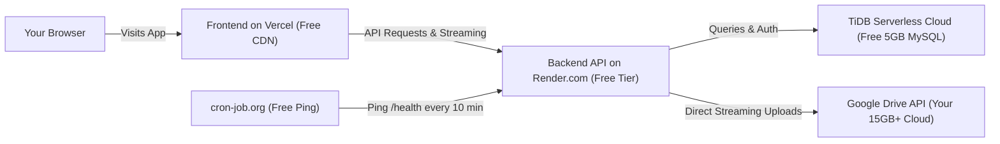

# 100% Free Deployment & Hosting Guide for 9Drive (Personal Use)

> **Estimated Setup Time:** ~15 to 20 minutes  
> **Total Monthly Cost:** **$0.00** (Permanently free for personal use)  
> **Difficulty:** Beginner / Intermediate  

---

## 📋 Architecture & The Best Free Stack

To run 9Drive online 24/7 without spending a penny, we use the following combination:



| Service | Component | Why it's chosen | Free Limits |
| :--- | :--- | :--- | :--- |
| **Vercel** | Frontend (React/Vite) | Lightning fast worldwide CDN, instant deploys, zero cold starts. | 100GB bandwidth/month (plenty for personal use) |
| **Render.com** | Backend (Express API) | Native Node.js support, free TLS/SSL HTTPS, simple GitHub CI/CD. | 750 free instance hours/month |
| **TiDB Cloud** or **Aiven** | Database (MySQL 8) | Wire-compatible MySQL 8+, fully managed cloud database. | 5GB free storage, auto-backups |
| **cron-job.org** | Keep-Alive Worker | Sends an automated HTTP GET ping to `/health` to prevent Render cold starts. | Unlimited free cron pings |

---

## ⏱️ Timeline Breakdown
1. **Cloud Database Setup (TiDB Cloud):** ~3 mins
2. **Google Cloud OAuth Setup:** ~5 mins
3. **Deploy Backend to Render:** ~4 mins
4. **Deploy Frontend to Vercel:** ~3 mins
5. **Setup Free Keep-Alive Ping:** ~2 mins
6. **Connect Google Drive & Verification:** ~2 mins

---

## 🛠️ Step 1: Create Your Free MySQL Database (3 mins)

9Drive requires a MySQL 8+ database. [TiDB Serverless](https://tidbcloud.com/) or [Aiven.io](https://aiven.io/) provides free cloud MySQL.

1. Go to **[TiDB Cloud](https://tidbcloud.com/)** and sign up (or sign in with GitHub/Google).
2. Click **Create Cluster** and select **Serverless (Free)**.
3. Choose the region closest to you (e.g. `us-east-1` or `eu-central-1`) and click **Create**.
4. Once created, click **Connect** in the dashboard.
5. In the connection modal:
   * Select **Connection Type:** `General` or `Prisma`.
   * Create a database name: `9drive` (or use default `test`).
   * Generate/view your database password.
6. Copy your connection string. It will look like:
   ```txt
   mysql://<username>:<password>@<host>:4000/9drive?sslaccept=strict
   ```
   *(Keep this connection string handy for Step 3).*

---

## 🔑 Step 2: Set Up Google Cloud OAuth (5 mins)

Google Cloud OAuth allows you to sign in with your Google account and grant 9Drive permission to store files into your dedicated `9drive` Google Drive folder.

1. Open **[Google Cloud Console](https://console.cloud.google.com/)**.
2. Click the top-left project dropdown and click **New Project** (e.g., name it `My-9Drive-Gateway`).
3. **Enable Google Drive API**:
   * In the search bar at the top, type `Google Drive API`.
   * Click on **Google Drive API** and click **Enable**.
4. **Configure OAuth Consent Screen**:
   * In the left sidebar, navigate to **APIs & Services > OAuth consent screen**.
   * Select **External** and click **Create**.
   * Fill in:
     * **App name:** `9Drive`
     * **User support email:** (Your email)
     * **Developer contact email:** (Your email)
   * Click **Save and Continue**.
   * On the **Scopes** page, click **Add or Remove Scopes**, check:
     * `.../auth/drive` (See, edit, create, and delete all of your Google Drive files)
     * `.../auth/userinfo.email`
     * `.../auth/userinfo.profile`
   * Click **Update**, then **Save and Continue**.
   * On the **Test Users** page (Crucial!):
     * Click **+ Add Users** and add your own Google email address (and any other accounts you plan to link).
     * Click **Save and Continue**.
5. **Create OAuth Client Credentials**:
   * In the left sidebar, go to **Credentials**.
   * Click **+ Create Credentials > OAuth client ID**.
   * Choose **Application type:** `Web application`.
   * Name: `9Drive Web Client`.
   * For now, leave **Authorized JavaScript origins** and **Authorized redirect URIs** blank (we will paste the exact Render & Vercel URLs in Step 6 once deployed).
   * Click **Create**.
   * Copy your **Client ID** and **Client Secret**.

---

## 🚀 Step 3: Deploy Backend on Render.com (4 mins)

1. Push this `9drive` repository to your personal **GitHub** account (Public or Private).
2. Go to **[Render.com](https://render.com/)** and sign in.
3. Click **New + > Web Service**.
4. Select **Build and deploy from a Git repository** and connect your `9drive` repo.
5. Fill in the deployment settings:
   * **Name:** `my-9drive-backend` (or your choice)
   * **Region:** Same general geographical area as your database (e.g., Oregon / Frankfurt / Singapore)
   * **Branch:** `main` (or your default branch)
   * **Root Directory:** `backend`
   * **Runtime:** `Node`
   * **Build Command:**
     ```bash
     npm install && npx prisma generate && npm run build
     ```
   * **Start Command:**
     ```bash
     npm run start:deploy
     ```
   * **Instance Type:** `Free`
6. Click **Advanced > Add Environment Variable** and add the following:

   | Key | Value | Description |
   | :--- | :--- | :--- |
   | `DATABASE_URL` | `mysql://...` | Connection string from Step 1 |
   | `FRONTEND_URL` | `https://your-app.vercel.app` | Temporary placeholder (update after Step 4) |
   | `JWT_ACCESS_SECRET` | *(Random 32+ char string)* | e.g. `9drive_super_secure_jwt_access_secret_2026_xyz` |
   | `TOKEN_ENCRYPTION_KEY` | *(Random 32 char string)* | Must be **exactly 32 characters** (e.g. `12345678901234567890123456789012`) |
   | `GOOGLE_CLIENT_ID` | Your Google Client ID | From Step 2 |
   | `GOOGLE_CLIENT_SECRET` | Your Google Client Secret | From Step 2 |
   | `GOOGLE_REDIRECT_URI` | `https://my-9drive-backend.onrender.com/connected-accounts/google/callback` | Replace with your Render URL |

7. Click **Create Web Service**.
8. Wait for Render to build and start the service.
9. Copy your backend URL: `https://<your-render-subdomain>.onrender.com`.

---

## 🌐 Step 4: Deploy Frontend on Vercel (3 mins)

1. Go to **[Vercel.com](https://vercel.com/)** and sign in with GitHub.
2. Click **Add New... > Project** and import your `9drive` repository.
3. Configure the project:
   * **Framework Preset:** `Vite`
   * **Root Directory:** Click **Edit** and select `frontend`.
   * **Build and Output Settings:** Keep defaults (`npm run build` and `dist`).
4. Under **Environment Variables**, add:
   * **Key:** `VITE_API_URL`
   * **Value:** `https://<your-render-subdomain>.onrender.com` (from Step 3)
5. Click **Deploy**.
6. When deployment finishes, copy your live frontend domain (e.g., `https://my-9drive.vercel.app`).

> [!TIP]
> A [`vercel.json`](file:///home/mushfiq/Desktop/9drive/frontend/vercel.json) rewrite file is already configured in this repository so all client-side routes (like `/settings`, `/quota-tracker`) refresh seamlessly.

---

## 🔄 Step 5: Sync URLs (2 mins)

Now update the mutual URLs between Google, Render, and Vercel:

1. **In Google Cloud Console:**
   * Go to **APIs & Services > Credentials** and edit your Web Client ID.
   * Under **Authorized JavaScript origins**, add:
     * `https://my-9drive.vercel.app`
   * Under **Authorized redirect URIs**, add:
     * `https://<your-render-subdomain>.onrender.com/connected-accounts/google/callback`
   * Click **Save**.
2. **In Render Dashboard:**
   * Go to your `my-9drive-backend` service > **Environment**.
   * Update `FRONTEND_URL` to match your Vercel URL: `https://my-9drive.vercel.app`.
   * Click **Save Changes** (Render will redeploy with the updated CORS origin).

---

## ⚡ Step 6: Keep the Free Backend 100% Awake (2 mins)

On Render's Free tier, services hibernate after 15 minutes of inactivity, causing a 30–50 second delay on the next visit.

Because 9Drive includes a lightweight `/health` endpoint (`GET /health`), you can set up a 100% free external pinger to keep it awake 24/7.

### Option A: cron-job.org (Recommended - Easiest & Fastest)
1. Go to **[cron-job.org](https://cron-job.org/)** and create a free account.
2. Click **Create Cronjob**.
3. **Title:** `9Drive Backend Keepalive`
4. **URL:** `https://<your-render-subdomain>.onrender.com/health`
5. **Execution schedule:** Every `10 minutes` (Render sleeps after 15 mins, so 10 mins prevents sleeping).
6. Click **Create**.
*That's it! Render will never sleep, and your personal drive will respond instantly.*

### Option B: Free GitHub Actions Scheduled Workflow
If you prefer keeping everything in your repo without external tools:
Create `.github/workflows/keepalive.yml`:
```yaml
name: Backend Keep-Alive
on:
  schedule:
    - cron: '*/10 * * * *' # Every 10 minutes
  workflow_dispatch:

jobs:
  ping:
    runs-on: ubuntu-latest
    steps:
      - name: Ping Health Endpoint
        run: curl -s https://<your-render-subdomain>.onrender.com/health
```

---

## 🏁 Step 7: First Login & Verification

1. Open your Vercel URL (`https://my-9drive.vercel.app`).
2. Click **Continue with Google and connect Drive** (or register an email/password account).
3. If logging in with email/password:
   * Go to **Settings > Google Credentials** to verify your Google Client ID/Secret.
   * Click **Connect Drive** and approve permissions for your Google account.
4. Go to **All Files** and upload a test file.
5. Check your Google Drive: you will see a root folder named `9drive` containing your uploaded file.
6. Connect additional Google accounts (e.g. secondary Gmail accounts with 15GB each) under **Settings > Connected Accounts** to pool your storage together for free!

---

## 🔒 Security Best Practices for Personal Free Hosting
- **Keep Google OAuth in "Testing" mode:** This restricts access only to your specified Gmail test accounts, preventing strangers from abusing your instance.
- **Never commit `.env` files:** All secrets are securely passed via Render/Vercel environment variables.
- **Data Privacy:** Files are never saved on the Render server filesystem—they stream directly to Google Drive via secure chunked buffers.
